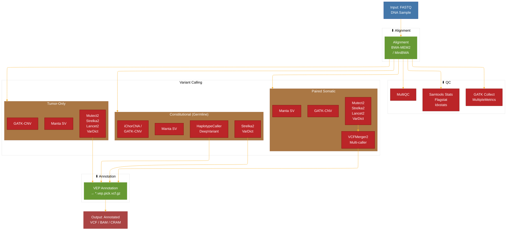
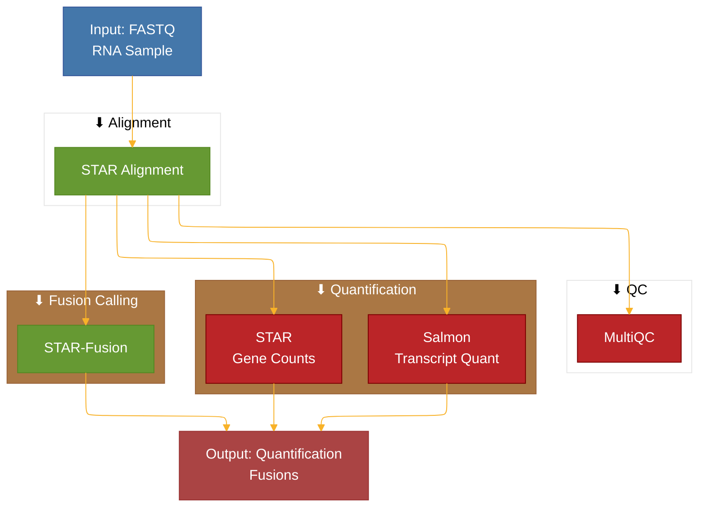
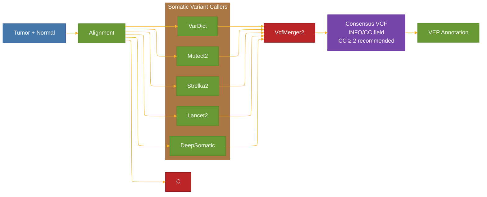

**GrandCanyon** is a JetStream workflow that supports the analysis of human sequencing
samples (both short-read Illumina and long-read PacBio HiFi/ONT data) against the
GRCh38 reference genome using Ensembl version 113 gene models. The workflow is designed to support project-level analysis that can
include one or multiple types of data. Though not required, the expectation is a
project contains data from a single individual, thus centralizing all data types
in a standardized output structure.

The workflow template supports a diverse array of analysis methods for DNA and RNA data.
Based on standardized variables, it also supports integrated analysis between data types. For some processes,
multiple options are provided that can be individually enabled or disabled by configuration parameters.

Like all [JetStream](https://github.com/tgen/jetstream) workflows developed at TGen, this
workflow is designed to facilitate dynamic and time-sensitive analysis needs while ensuring compute
and storage resources are used efficiently. The primary input is a JSON file, that for most internal
users will be generated by the TGen LIMS. For configuring this JSON, see the [Configuration Guide](../getting-started/configuration/).

## How GrandCanyon Pairs Samples

GrandCanyon automatically pairs compatible data types together for analysis, intelligently
handling both short-read and long-read data types:

- **Tumor + Constitutional WGS/WES**: Paired for somatic variant calling
- **Multiple tumors + single constitutional**: Each tumor paired separately with the constitutional sample
- **Exome + Exome**: Exome data only pairs with other exome data (not genome or RNA)
- **DNA + RNA**: Paired for integrated DNA/RNA analysis using the `dnaRnaMergeKey`

[^1]: Additional restrictions can be enabled to only pair samples with matching `assayCode`.

## What GrandCanyon Analyzes

### DNA Analysis Pipeline

GrandCanyon supports both short-read (Illumina) and long-read (PacBio HiFi, Oxford Nanopore) sequencing data.

- **Alt-Aware Alignment**: BWA-MEM2 / MiniBWA (Short-read), Minimap2 (Long-read), VG Giraffe (Pangenome)
- **De Novo Assembly**: Flye, HiFiASM, Verkko, Shasta (Long-read)
- **QC Metrics**: Samtools Stats, Flagstat, Idxstats; GATK CollectMultipleMetrics
- **SNV/INDEL Variant Calling**:
  - Short-read: GATK HaplotypeCaller, DeepVariant, Strelka2, VarDict
  - Long-read: DeepVariant (Pangenome), Clair3, ClairS
  - Paired somatic and tumor-only: Mutect2, DeepSomatic, Strelka2, Lancet2, VarDict (merged by VcfMerger2)
- **Structural Variant Calling**:
  - Short-read: Manta (Constitutional, Paired somatic, Tumor-only)
  - Long-read: Sniffles, cuteSV, PBSV, Dysgu, Savana, Severus
  - Specialized: tRGT (tandem repeats)
- **Copy Number Analysis**:
  - iChorCNA (Constitutional)
  - GATK-CNV (Constitutional, Paired somatic, Tumor-only)
- **Methylation Analysis** (Long-read):
  - ModKit, RASTair, methbat

### RNA Analysis Pipeline

GrandCanyon supports both short-read (Illumina) and long-read (PacBio Kinnex, Oxford Nanopore) RNA-seq analysis.

- **Short-read Alignment & Quantification**: STAR, Salmon
- **Long-read Alignment**: Minimap2 (PacBio, ONT)
- **Long-read Isoform Discovery**: IsoSeq (PacBio), Flair, IsoQuant
- **Long-read Quantification**: Oarfish, IsoQuant
- **Isoform Classification**: Pbpigeon, SQANTI3
- **Fusion Calling**: STAR-Fusion (short-read), CTAT-LR (long-read)
- **QC Metrics**

## Workflow Diagrams

### DNA Workflow

### RNA Workflow

### Somatic Variant Caller Overview

When matched tumor-normal data is available, GrandCanyon runs **five somatic variant callers** and merges results:

## See Also

- [Configuration Guide](../getting-started/configuration/) - How to configure input data
- [Execution Guide](../getting-started/execution-guide/) - How to run the pipeline
- [Tool Descriptions](../reference/tool-descriptions/) - Detailed tool catalog
- [Interpreting Outputs](../analysis/interpreting-outputs/) - Understanding results
- [Glossary](../reference/glossary/) - Terminology reference

[^1]: Additional restrictions can be enabled to only pair samples with matching `assayCode`.
